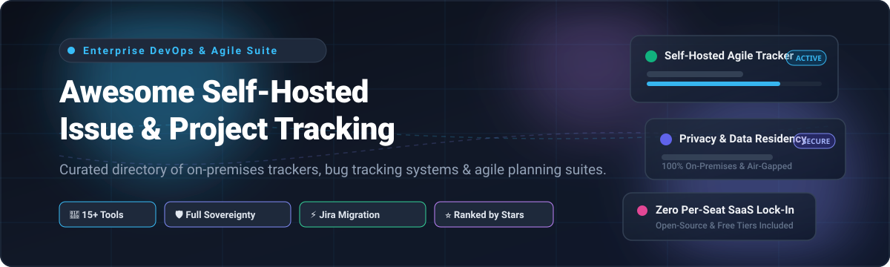

  

# 🚀 Awesome-Self-Hosted-Issue-Project-Tracking

  
  
  
  
  
  
  

> 📌 A curated directory of top **Self-Hosted Issue & Project Tracking** software, enterprise on-premises project management tools, bug trackers, and open-source agile planning platforms.

---

## 🧭 Top Self-Hosted Issue & Project Tracking Ecosystem

**Curated Directory of Enterprise SaaS / Self-Managed Platforms & Open-Source GitHub Projects** 💻  
*Focused on On-Premises Issue Tracking, Agile Planning, Bug Tracking, Kanban Boards & Self-Managed DevOps Workflows* 🎯  

**Last updated: October 2026** 📅

This repository tracks premier **commercial/SaaS platforms** offering self-managed or on-premises editions and active **open-source projects** for **Self-Hosted Issue & Project Tracking**. These solutions enable engineering teams, DevOps practitioners, and privacy-conscious enterprises to manage bugs, sprints, tasks, and roadmaps entirely on infrastructure they own and control—preserving data residency, satisfying strict compliance policies (GDPR, HIPAA, SOC 2), preventing per-seat SaaS lock-in, and unlocking deep database-level customization. 🛡️

---

## 📑 Table of Contents

- [📊 Sector Overview & Market Dynamics](#-sector-overview--market-dynamics)
- [🏢 SaaS & Commercial Self-Managed Platforms](#-saas--commercial-self-managed-platforms)
- [⭐ Open-Source GitHub Projects](#-open-source-github-projects)
- [🧩 Framework Selection Matrix](#-framework-selection-matrix)
- [🤝 How to Contribute](#-how-to-contribute)
- [💖 Support](#-support)
- [📈 Star History](#star-history)
- [⚠️ Disclaimer & Lifecycle Notes](#️-disclaimer--lifecycle-notes)

---

## 📊 Sector Overview & Market Dynamics

The global project portfolio management and issue tracking software sector is estimated at **$7.5 billion in 2026** (projected to exceed $12 billion by 2030 at an ~11.5% CAGR) 📈. The market is **moderately fragmented**: mega-cap hyper-scalers and established enterprise giants (Microsoft/GitHub, Atlassian, GitLab) dominate mainstream developer workflows and high-volume corporate contracts, while an agile and fast-growing tier of modern open-core and privacy-centric vendors capture significant market share among sovereignty-focused European enterprises, government/defense contractors, and developer teams seeking modern alternatives to Jira's sunsetting on-premise footprint 🌐.

---

## 🏢 SaaS & Commercial Self-Managed Platforms

The table below lists leading commercial self-managed and enterprise-hosted issue/project tracking solutions, sorted descending by **company scale (market valuation / revenue)** 💰.

| Platform / Vendor | Company Scale (Valuation / Revenue) 💼 | Starting Pricing (Paid Tiers) 🏷️ | Free Tier / Trial Limits 🎁 | Deployment & Compliance Profile 🔒 |
| :--- | :--- | :--- | :--- | :--- |
| **[GitHub Enterprise Server](https://github.com/enterprise)** | ~$3.1T Market Cap (Parent: Microsoft Corp / $1B+ GitHub ARR) | **$21/user/month** (Enterprise plan billed annually) | **45-day free trial** for GitHub Enterprise Server with full enterprise feature access; Cloud Free tier available indefinitely for public/private repos with 2,000 CI Actions min/mo | Bare-metal, AWS, Azure, GCP, or VMware appliance; full GitHub Actions, Git, and issue/project board management behind company firewalls 🛡️ |
| **[GitLab Self-Managed](https://about.gitlab.com/)** | ~$8.5B Market Cap (~$750M ARR) | **$29/user/month** (Premium tier, billed annually at $348/user/year) | **30-day free trial** of GitLab Ultimate self-managed; **GitLab Community Edition (CE)** is free forever with core Git repo management and issue boards | Omnibus packages, Docker container, and Kubernetes Helm charts; full source control, CI/CD pipelines, container registry, and security governance 🦊 |
| **[Jira Data Center](https://www.atlassian.com/software/jira)** | ~$45B Market Cap (~$4.5B ARR, Atlassian) | **$44,000/year** (fixed entry starting tier for 500 users) | **30-day free evaluation license** (extendable up to 90 days); Jira Cloud offers a free forever tier capped at 10 users with 2 GB storage | Multi-node clustered deployment for high availability; new licenses discontinued March 30, 2026; license expansions end March 2028; full EOL March 28, 2029 ⏳ |
| **[YouTrack Server](https://www.jetbrains.com/youtrack/)** | ~$3.5B Valuation (~$450M Annual Revenue, JetBrains) | **$4.50/user/month** (Server subscription billed annually for 15+ users, or one-off perpetual package at ~$60/user) | **Free forever plan for up to 10 users** with full features, complete search syntax, and Gantt charts; **14-day free trial** for larger teams | ZIP archive, Docker image; native knowledge base, agile boards, time tracking, smart search, and helpdesk integration ⚡ |
| **[Jira Server](https://www.atlassian.com/software/jira)** | ~$45B Market Cap (Atlassian) | **Discontinued / Not Sold** (Previously ~$10 one-time starter up to 10 users) | **None** (End of Life reached February 15, 2024; strictly zero support, no security patches, and no trial licenses available) | Legacy single-node server; compliance liability—do not deploy for new installations 🛑 |

---

## ⭐ Open-Source GitHub Projects

The following curated open-source projects provide complete self-hosted control, arranged in descending order by **GitHub_Stars** ✨.

| Project 📦 | GitHub_Stars ⭐ | License 📜 | Primary Tech Stack 🛠️ | Key Focus & Strengths 💡 |
| :--- | :---: | :--- | :--- | :--- |
| **[Plane](https://github.com/makeplane/plane)** |  | AGPL-3.0 | Next.js, Django, Python, PostgreSQL, Redis | Modern Jira and Linear alternative with work items, cycles (sprints), modules, and multiple view modes (List, Board, Spreadsheet, Gantt, Calendar). 🚀 |
| **[Gitea](https://github.com/go-gitea/gitea)** |  | MIT | Go, JavaScript | Painless self-hosted all-in-one software development service featuring lightweight Git hosting, milestone/issue tracking, and Kanban boards. ☕ |
| **[Focalboard](https://github.com/mattermost-community/focalboard)** |  | AGPL-3.0 / MIT | Go, TypeScript, React | Multilingual open-source, self-hosted alternative to Trello, Notion, and Asana; provides Kanban, table, calendar, and gallery views. 📋 |
| **[Wekan](https://github.com/wekan/wekan)** |  | MIT | Meteor, Node.js, MongoDB | Collaborative open-source Kanban board app built with Meteor; supports swimlanes, custom fields, user permissions, and audit logs. 📑 |
| **[OpenProject](https://github.com/opf/openproject)** |  | GPL-3.0 / AGPL-3.0 | Ruby on Rails, Angular, PostgreSQL | Enterprise-grade project management with interactive Gantt charts, Scrum backlogs, sprint boards, time tracking, budgets, and cost reporting. 📊 |
| **[Planka](https://github.com/plankanban/planka)** |  | AGPL-3.0 | Node.js, React, Redux, PostgreSQL | Elegant real-time Kanban board for agile workgroups; features board background customization, track timers, subtasks, and markdown cards. 🎨 |
| **[Phabricator](https://github.com/phacility/phabricator)** |  | Apache-2.0 | PHP, MySQL | Historic software development suite developed by Facebook; includes Maniphest task tracker and Differential code reviewer *(Note: Upstream unmaintained; see Phorge)*. 🏛️ |
| **[Leantime](https://github.com/Leantime/leantime)** |  | AGPL-3.0 | PHP, JavaScript, MySQL | Strategic and lean project management system tailored for non-project managers, cross-functional teams, and startups; includes milestones, Gantt, and idea boards. 💡 |
| **[Kanboard](https://github.com/kanboard/kanboard)** |  | MIT | PHP, SQLite / MySQL / PostgreSQL | Minimalist visual task board software adhering strictly to Kanban methodology, featuring automated workflows, subtasks, and minimal server footprints. 📌 |
| **[Kaneo](https://github.com/usekaneo/kaneo)** |  | MIT | TypeScript, Node.js | Clean and ultra-fast open-source project management platform featuring built-in free SSO, native Jira project migrations, and responsive Kanban boards. ⚡ |
| **[Redmine](https://github.com/redmine/redmine)** |  | GPL-2.0 | Ruby on Rails, MySQL / PostgreSQL / SQLite | Battle-tested veteran issue tracking web application with flexible role-based access control, Gantt charts, wikis, and an extensive third-party plugin ecosystem. 💎 |
| **[Vikunja](https://github.com/go-vikunja/vikunja)** |  | AGPL-3.0 | Go, TypeScript, Vue.js | Modern and snappy to-do and task management platform supporting Kanban boards, Gantt timelines, list views, reminders, and cross-platform clients. 🎯 |
| **[Taiga](https://github.com/taigaio/taiga-docker)** |  | MPL-2.0 | Python, Django, AngularJS | Purpose-built Agile project management platform for Scrum and Kanban enthusiasts, featuring sprint planning, epics, user stories, and burndown analytics. 🏃 |
| **[MantisBT](https://github.com/mantisbt/mantisbt)** |  | GPL-2.0 | PHP, MySQL / PostgreSQL | Lightweight web-based bug tracking system balancing power with straightforward simplicity, rich email notifications, and mobile-friendly layouts. 🐛 |
| **[Bugzilla](https://github.com/bugzilla/bugzilla)** |  | MPL-2.0 | Perl, MySQL / PostgreSQL / Oracle | Mozilla's enterprise-grade defect and bug tracking system equipped with advanced search queries, automated workflows, and battle-tested security. 🔍 |
| **[Trac](https://github.com/edgewall/trac)** |  | BSD-3-Clause | Python, SQLite / PostgreSQL / MySQL | Enhanced minimalist wiki and issue tracking platform for software development projects, linking commits, tickets, and wiki documentation seamlessly. 🔗 |
| **[Phorge](https://github.com/phorgeit/phorge)** |  | Apache-2.0 | PHP, MySQL | Community-driven and actively maintained upstream fork of Phabricator, providing task management, Git/Mercurial hosting, and Differential code reviews. 🛠️ |

---

## 🧩 Framework Selection Matrix

Depending on organizational requirements, consider the following trade-offs:

1. **Enterprise Traditional Project Management (Budgets, Milestones & Gantt)** 🏢:
   - Choose **[OpenProject](https://github.com/opf/openproject)** or **[Redmine](https://github.com/redmine/redmine)**.
   - *Advantage*: Native Gantt tracking, resource baselines, cost accounting, and deep role/permission hierarchies.

2. **Modern Developer & Linear/Jira Replacements** ⚡:
   - Choose **[Plane](https://github.com/makeplane/plane)** or **[Kaneo](https://github.com/usekaneo/kaneo)**.
   - *Advantage*: Fluid keyboard shortcuts, cycle/sprint management, clean modern UI, and direct Jira import capabilities.

3. **Lightweight & Agile Kanban Teams** 📋:
   - Choose **[Planka](https://github.com/plankanban/planka)**, **[Wekan](https://github.com/wekan/wekan)**, or **[Kanboard](https://github.com/kanboard/kanboard)**.
   - *Advantage*: Low memory footprint, near-zero admin overhead, fast Docker setup, and zero-clutter Kanban workflows.

4. **Integrated All-in-One Code Hosting + Issue Tracking** 🔧:
   - Choose **[Gitea](https://github.com/go-gitea/gitea)** or **[GitLab Self-Managed](https://about.gitlab.com/)**.
   - *Advantage*: Direct bidirectional linking between Git commits, pull requests, CI/CD pipelines, and issue tickets.

5. **Pure Scrum Discipline** 🏃:
   - Choose **[Taiga](https://github.com/taigaio/taiga-docker)**.
   - *Advantage*: Out-of-the-box user story estimation, burndown charts, and backlog prioritization.

---

## 🤝 How to Contribute

We welcome community suggestions, updates, and corrections! 🙌

1. Fork this repository 🍴
2. Update `README.md` with your proposed addition or revision (maintain star sorting and table structure) 📝
3. Verify that repository links, licenses, and pricing limits are accurate and factual 🔍
4. Submit a Pull Request with a clear summary of your changes 🚀

---

## 💖 Support

Thank you for exploring and utilizing this curated open-source index! If you find this repository valuable, please consider supporting the project:

- ⭐ **Star this repository** to help others discover it!
- 🍴 **Fork and share** it with your fellow engineering leads, developers, and DevOps teammates!
- ☕ **Buy a coffee / Sponsor**: Support ongoing maintenance and curation via the [GitHub Sponsors Dashboard](https://github.com/sponsors/ishandutta2007) ❤️

---

##  Star History

---

## ⚠️ Disclaimer & Lifecycle Notes

- This is an independently curated community resource and is not officially affiliated with Atlassian, Microsoft, GitLab, JetBrains, or any project listed.
- **Jira Server Lifecycle**: Officially reached End of Life (EOL) on **February 15, 2024**. No updates, security patches, or bug fixes are issued. Running Jira Server introduces significant compliance and vulnerability risks 🛑.
- **Jira Data Center Lifecycle**: New license sales were sunset on **March 30, 2026**; license tier expansions terminate on **March 30, 2028**; full EOL occurs on **March 28, 2029**, after which instances become read-only ⏳.
- **Phabricator Status**: Phacility ceased operations in 2021. For active development, choose community fork **[Phorge](https://github.com/phorgeit/phorge)** 🛠️.
- **Self-Hosting Responsibility**: Deploying on-premises issue tracking software requires dedicated operational management, including automated database backups, TLS certificate rotations, network security isolation, and regular security patching 🔒.
